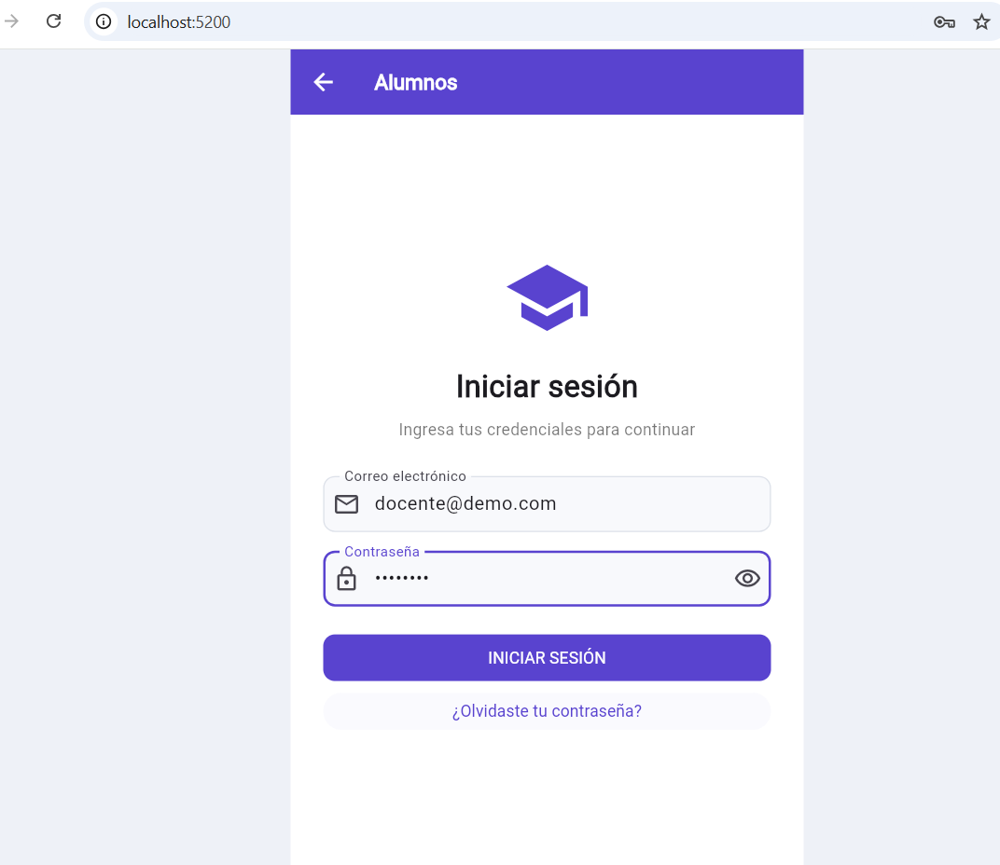
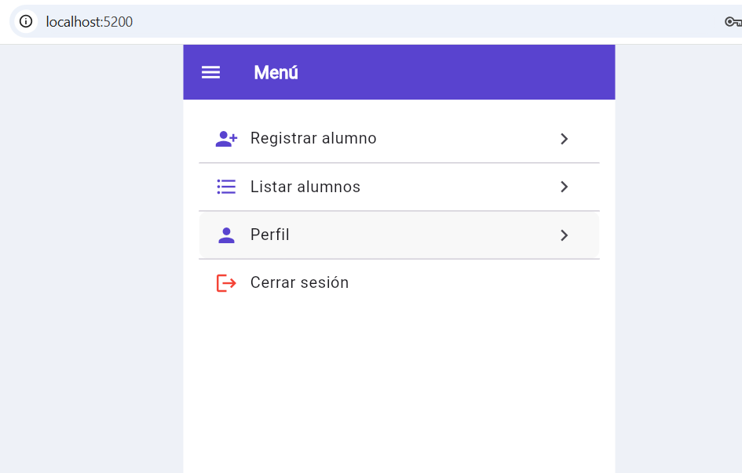
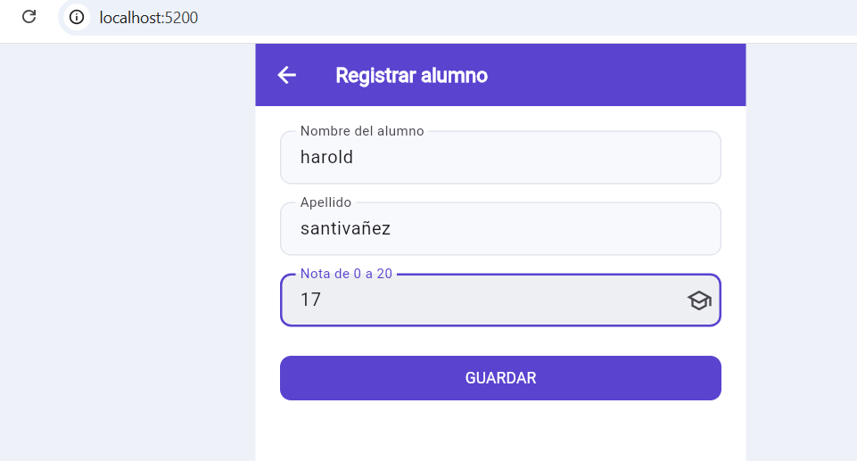
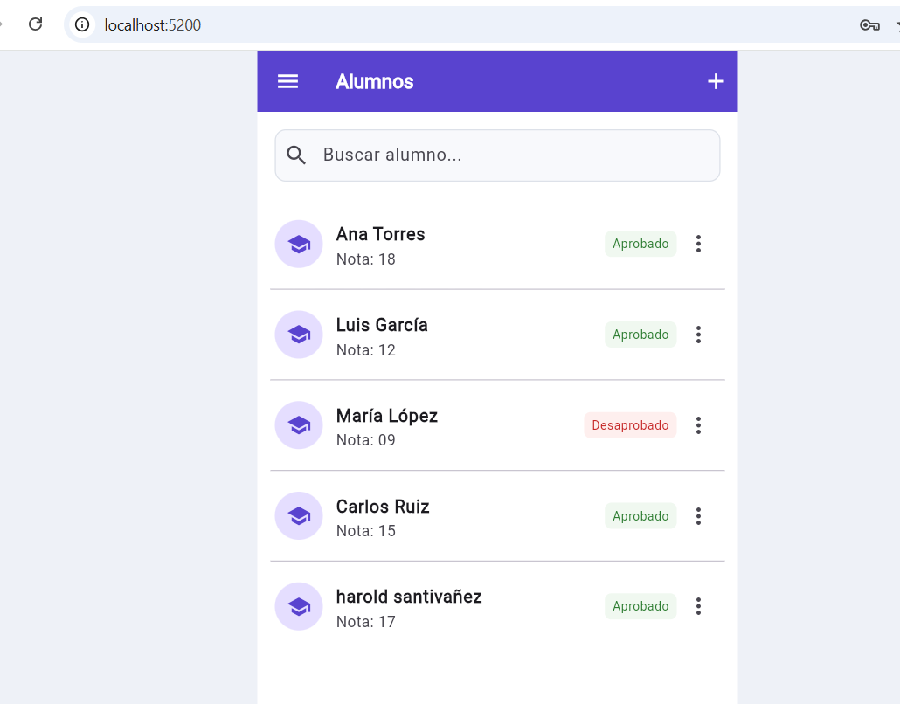
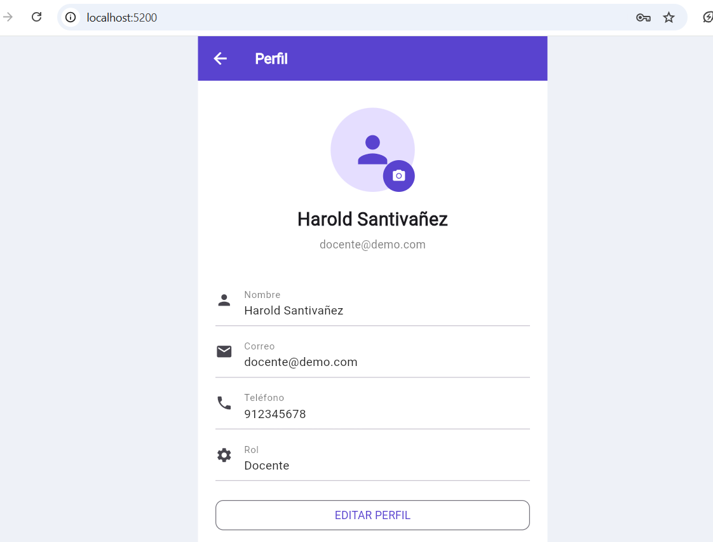

# Gestión de alumnos con Flutter

Entrega de la sección A. La aplicación permite iniciar sesión, registrar alumnos y consultar sus notas con su estado de aprobación. En la pantalla inicial se debe seleccionar **Alumnos**.

## Funciones

- Inicio de sesión con validación del correo y contraseña.
- Menú con acceso al registro, listado y perfil, además del cierre de sesión.
- Registro y edición de nombre, apellido y nota entre 0 y 20.
- Listado con buscador y estado de aprobado o desaprobado.
- Eliminación con confirmación.
- Perfil con edición de datos y selección de foto.
- Guardado local mediante SharedPreferencesAsync y JSON.

El criterio implementado es aprobar desde **11 sobre 20**. El acceso es una demostración local y no utiliza un servidor de autenticación.

## Ejecución

Se requiere Flutter 3.35 o posterior y Chrome. Desde una terminal:

```bash
git clone https://github.com/haroldsantivanez-ship-it/laboratorio-flutter-alumnos.git
cd laboratorio-flutter-alumnos
flutter pub get
flutter run -d chrome --web-port 5200
```

El proyecto utiliza `image_picker` para seleccionar fotos y `shared_preferences` para el almacenamiento local.

### Cuenta de demostración de alumnos

| Correo | Contraseña |
| --- | --- |
| docente@demo.com | Demo1234 |

Si se modifica el correo en el perfil, se debe utilizar el nuevo correo al volver a iniciar sesión. La opción de contraseña muestra los datos de acceso locales actuales.

## Código principal

| Archivo | Contenido |
| --- | --- |
| `lib/main.dart` | Pantallas, formularios, validación y navegación. |
| `lib/app_store.dart` | Modelos, operaciones sobre los registros y almacenamiento. |
| `test/widget_test.dart` | Pruebas de la lógica y del acceso a la interfaz. |

Los cambios se guardan en el mismo navegador y origen. Los datos de las capturas corresponden a una ejecución de prueba; una primera ejecución en otro navegador utiliza los registros iniciales del código.

## Pruebas

```bash
flutter test
```

La ejecución documentada del 17 de octubre de 2026 terminó con **cinco pruebas aprobadas**. Las comprobaciones relacionadas con alumnos incluyen credenciales, validación de notas, límite de aprobación, operaciones sobre alumnos, actualización del correo y navegación de acceso y cierre de sesión.

[Ver el resultado de las pruebas](docs/capturas/06_pruebas_flutter.png).

## Informe

- [Informe final en PDF](docs/Informe_final_seccion_A_alumnos.pdf)
- [Informe editable en Word](docs/Informe_final_seccion_A_alumnos.docx)

El informe incluye las pantallas de la sección A y fragmentos de código con su explicación al costado.

## Capturas de la sección A

### Inicio de sesión



### Menú



### Registro



### Listado



### Perfil


